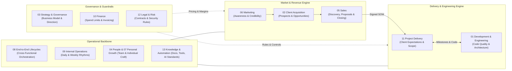

# Agency Operating Knowledge Base

Welcome to the operating knowledge base for our technology-services agency and startup.

This repository serves as the single source of truth for how the agency plans, organizes, delivers, governs, and continuously improves its operations.

---

## 1. What This Repository Is

This is a Markdown-based operational architecture designed to support:
- **Clear responsibilities:** Defined ownership across 13 core business categories.
- **Documented working practices:** Reusable workflows, checklists, and situational playbooks that guide execution.
- **Appropriate mandatory rules:** Clear policies, spending controls, and legal boundaries.
- **Flexible judgment:** Playbooks designed to guide human discretion without rigid micromanagement.
- **Reliable coordination:** Clean handoffs between sales, delivery, engineering, and finance.
- **Knowledge preservation:** Lessons learned, decision logs, and research records that persist as the team grows.
- **Machine and AI readiness:** Structured, version-controlled documentation that human team members and AI assistants can reliably navigate and maintain.

## 2. Who It Is For

- **Founders:** For strategic governance, capital allocation, decision rights, and agency-level roadmaps.
- **Team Members & Contractors:** For day-to-day execution, coding standards, project delivery workflows, and operational hygiene.
- **Commercial & Sales Leads:** For prospect qualification, scoping, pricing boundaries, and proposal generation.
- **External Advisors (CPAs, Legal Counsel):** For inspecting governing policies, contractual boundaries, and financial controls.
- **AI Coding & Operational Agents:** For automated research synthesis, documentation maintenance, and workflow assistance governed by strict contribution rules.

## 3. Scope of the Knowledge Base

This knowledge base covers the **entire agency lifecycle**, balancing client-facing execution with internal operational integrity:

1. **Commercial Engine:** Client Acquisition, Sales, and Marketing.
2. **Delivery & Engineering Engine:** Development and Engineering, Project Delivery, and Client Service.
3. **Internal Governance & Operations:** Business Strategy, Internal Operations, People Management, and Personal Growth.
4. **Guardrails & Risk Management:** Finance and Money Management, Legal, Security, and Risk Management.
5. **Preservation & Synthesis:** End-to-End Lifecycles, Knowledge, Systems, and Automation.

## 4. Current Stage of Development

> [!IMPORTANT]
> **Current Status: Architectural Scaffolding & Initial Design.**
> 
> This repository is currently in its initial structural scaffolding phase. All 13 categories, candidate playbooks, and suggested workflows are **proposed concepts** for future research and founder discussion.
> 
> **Do not confuse a proposed structure with an approved company policy.** No binding financial commitments, legal obligations, or performance mandates are active until formally approved by the founders and marked with `status: approved`.

## 5. How to Navigate the Repository

The repository is organized into distinct, modular directories:

```text
Playbook/
├── README.md                           # This orientation guide
├── structure-guide.md                  # Comprehensive architectural guide & conventions
├── category-roadmap.md                 # Development progress tracker for all 13 categories
├── open-questions.md                   # Register of unresolved strategic & operational questions
├── ai-contribution-guide.md            # Mandatory rules for AI assistants and contributors
│
├── categories/                         # The 13 operational responsibility categories
│   ├── 01-development-and-engineering/ # Tech architecture, code quality, deployment, testing
│   ├── 02-client-acquisition/          # Prospect research, outreach, referrals ("CA" = Client Acquisition)
│   ├── 03-business-strategy-and-governance/ # Business model, service catalog, decision rights
│   ├── 04-people-and-relationship-management/ # Hiring, contractor vetting, onboarding, feedback
│   ├── 05-sales/                       # Discovery, scoping, pricing, proposals, closing, handoffs
│   ├── 06-marketing/                   # Brand, content, case studies, website, thought leadership
│   ├── 07-personal-and-professional-growth/ # Individual craft, communication, role-play practice
│   ├── 08-end-to-end-agency-and-startup/    # Cross-category lifecycles (client journey, agency launch)
│   ├── 09-internal-operations-and-work-management/ # Weekly rhythm, task boards, meeting hygiene
│   ├── 10-finance-and-money-management/ # Cash flow, invoicing, reserves, spend limits, payroll
│   ├── 11-project-delivery-and-client-service/ # Kickoff, milestones, scope changes, UAT, handover
│   ├── 12-legal-security-and-risk-management/  # Contracts, IP, confidentiality, secrets, compliance
│   └── 13-knowledge-systems-and-automation/    # Knowledge governance, ODRs, AI ethics, automation
│
├── templates/                          # Standardized templates for all official document types and system contracts
├── decisions/                          # Formal Operating Decision Records (ODRs)
├── research/                           # Central repository for external benchmarks & research notes
│   ├── 01-development-and-engineering/ # Engineering evidence register, candidate practices, validation
│   └── production-lifecycle/           # 8-phase application production lifecycle reference framework
├── ideas/                              # Staging area for raw concepts & review records
├── meetings/                           # Formal records of team discussions & agendas
└── archive/                            # Superseded and retired documentation
```

For complete architectural details, see the [`structure-guide.md`](./structure-guide.md).

## 6. Distinguishing Draft Material from Approved Instructions

Every document in this repository uses a standardized YAML metadata frontmatter block that specifies its official lifecycle status:

| Status Tag | Operational Meaning | Authority Level |
| :--- | :--- | :--- |
| `status: proposed` | Under early consideration; candidate idea. | Informational only. Not active. |
| `status: draft` | Actively being authored or modified. | Work-in-progress. Do not rely on for operations. |
| `status: in-review` | Complete draft submitted for founder/stakeholder sign-off. | Pre-operational. Under formal evaluation. |
| `status: approved` | Formally authorized by human founders. | **Active, binding agency standard.** |
| `status: superseded` | Deprecated and moved to `archive/` or tombstoned. | Historical reference only. |

## 7. How Categories Connect (Boundaries & Handoffs)

To prevent duplication and operational conflict, categories maintain strict boundaries and interact via documented handoffs:



- **Marketing vs. Client Acquisition vs. Sales:** Marketing creates authority; Client Acquisition creates qualified prospect conversations; Sales closes commercial commitments.
- **Strategy vs. Internal Operations:** Strategy sets the destination and decision rights; Internal Operations coordinates daily/weekly execution.
- **Engineering vs. Project Delivery:** Engineering owns technical implementation and code quality; Delivery owns client satisfaction, milestones, and scope boundaries.
- **Finance Ownership:** Finance owns money controls, spend thresholds, and cash visibility. Other categories link to Finance rather than creating ad-hoc rules.
- **End-to-End Scope:** Category 08 maps cross-functional lifecycles by linking to specialized playbooks—it never duplicates functional procedures.
- **Documentation Standards vs. Content Accuracy:** Category 13 governs repository formatting and AI usage; each individual category owns the factual accuracy of its content.

## 8. Where to Start Contributing

1. **Review the Roadmap:** Check [`category-roadmap.md`](./category-roadmap.md) to understand current progress and priority areas.
2. **Review Open Questions:** Read [`open-questions.md`](./open-questions.md) to identify foundational business decisions awaiting debate.
3. **Follow the AI Guidelines:** If contributing as or with an AI assistant, strictly adhere to [`ai-contribution-guide.md`](./ai-contribution-guide.md).
4. **Use Standard Templates:** When authoring new policies, workflows, or playbooks, always start from [`templates/`](./templates/README.md).
5. **Centralize Research:** File all external citations, benchmarks, and market observations in [`research/`](./research/README.md).
6. **Capture Ideas:** File raw brainstorming suggestions in [`ideas/`](./ideas/README.md).
