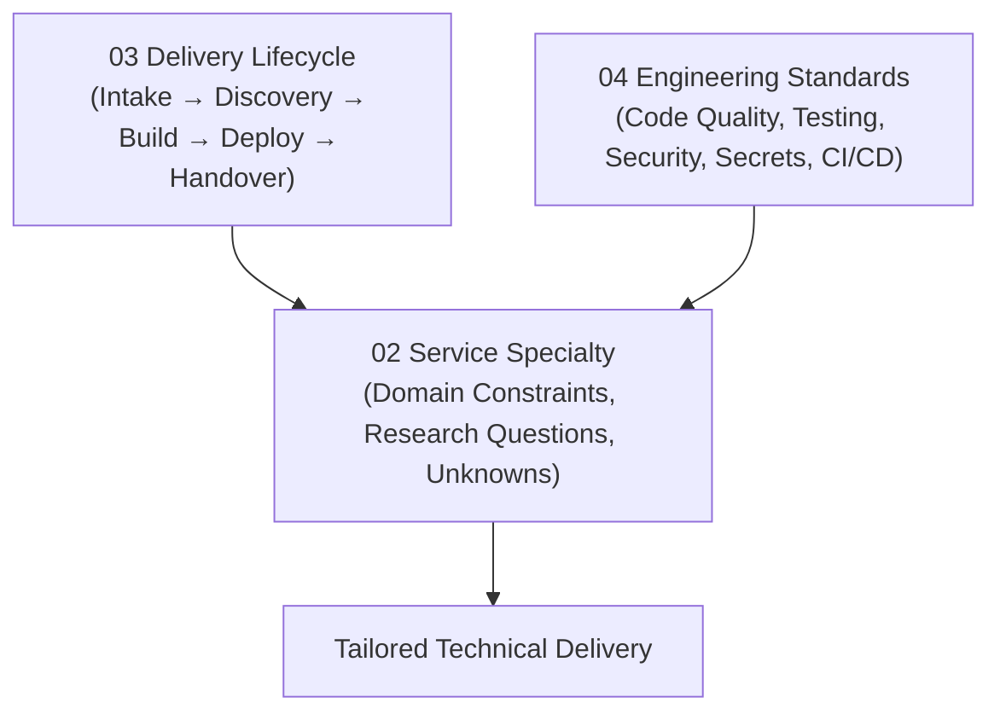

# 02. Service Specialties

> [!NOTE]
> **Candidate Practice / Proposed Scaffolding:** This document contains candidate material for research and evaluation. It does not constitute approved agency policy, mandatory instruction, or contractual commitment until formally reviewed and marked with `status: approved`.

This directory houses candidate technical service specialties that the agency may research, develop, and deliver.

> [!WARNING]
> **Service Specialties are NOT Approved Commercial Offerings.**
> 
> The documents in this directory represent **technical domain investigations**, not committed or active commercial service offerings. 
> 
> The official commercial service catalog is governed exclusively by [`../../03-business-strategy-and-governance/`](../../03-business-strategy-and-governance/README.md). All specialties in this folder maintain an **activation status of "unconfirmed"** until validated and approved by agency leadership. No specific technology stacks or frameworks are prescribed here.

## Purpose

To provide a structured home for domain-specific engineering considerations, specialized risks, constraints, and research questions without duplicating shared lifecycle steps or cross-cutting engineering standards.

## How Specialties Connect to Standards and Lifecycle

Specialties define *domain-specific nuances*; they rely on shared foundational documents for general execution:
- **Delivery Lifecycle (`03-delivery-lifecycle/`):** Governs how technical work moves from intake to handover.
- **Engineering Standards (`04-engineering-standards/`):** Governs reusable technical practices (code review, testing, secrets, CI/CD).
- **Specialty Document:** Adds *only* domain-specific constraints (e.g., mobile app store review delays, AI model drift, webhook retry storms).

## Candidate Specialties Index

| Specialty Document | Candidate Technical Domain | Activation Status |
| :--- | :--- | :---: |
| [`service-catalog.md`](./service-catalog.md) | Technical capability evaluation catalog | Unconfirmed |
| [`web-applications-and-websites.md`](./web-applications-and-websites.md) | Web applications, SPAs, SSR portals, marketing sites | Unconfirmed |
| [`mobile-applications.md`](./mobile-applications.md) | Native and cross-platform mobile apps (iOS, Android) | Unconfirmed |
| [`backend-apis-and-integrations.md`](./backend-apis-and-integrations.md) | REST/GraphQL APIs, microservices, third-party integrations | Unconfirmed |
| [`automation-and-business-systems.md`](./automation-and-business-systems.md) | Workflow automations, webhooks, iPaaS, internal tools | Unconfirmed |
| [`ai-applications-and-agents.md`](./ai-applications-and-agents.md) | LLM applications, autonomous agents, RAG systems | Unconfirmed |
| [`data-engineering-and-analytics.md`](./data-engineering-and-analytics.md) | ETL/ELT data pipelines, warehouses, reporting systems | Unconfirmed |
| [`cloud-and-platform-engineering.md`](./cloud-and-platform-engineering.md) | Infrastructure-as-code, serverless, container platforms | Unconfirmed |
| [`desktop-applications.md`](./desktop-applications.md) | Cross-platform desktop apps (Electron, Tauri, native) | Unconfirmed |
| [`e-commerce-and-transactional-web.md`](./e-commerce-and-transactional-web.md) | E-commerce storefronts, checkout, payment tokenization | Unconfirmed |
| [`low-code-and-cms-platforms.md`](./low-code-and-cms-platforms.md) | Headless/monolithic CMS, visual builders, low-code automations | Unconfirmed |
| [`messaging-bots-and-conversational-agents.md`](./messaging-bots-and-conversational-agents.md) | WhatsApp, Telegram, Slack bots, conversational UI | Unconfirmed |

## Related Agency Categories

- [`../../03-business-strategy-and-governance/README.md`](../../03-business-strategy-and-governance/README.md): Commercial service offering definition and pricing models.
- [`../../05-sales/README.md`](../../05-sales/README.md): Scoping and feasibility inputs.
- [`../../11-project-delivery-and-client-service/README.md`](../../11-project-delivery-and-client-service/README.md): Client expectation management for specialized deliverables.

## Open Questions

- Which 1–2 specialties will form the agency's primary initial market focus?
- What depth of in-house technical capability is required before an unconfirmed specialty can be activated commercially?
