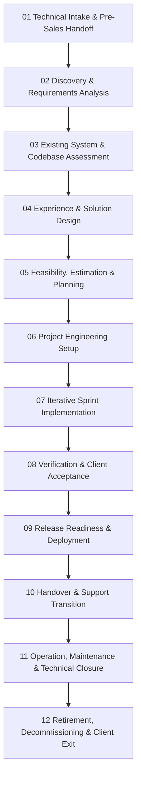

# 03. Technical Delivery Lifecycle

This directory defines the proposed 12-stage technical progression of software, application, and automation deliverables—tracing work from initial pre-sales intake through discovery, engineering setup, iterative build, deployment, client handover, operational maintenance, and eventual decommissioning.

## Purpose

To provide a transparent, repeatable, and disciplined technical delivery lifecycle that defines engineering inputs, actions, verification criteria, and handoffs at each milestone, ensuring predictable quality and smooth client transitions.

## Key Boundary with Project Delivery (Category 11)

- **Project Delivery and Client Service ([`../../11-project-delivery-and-client-service/`](../../11-project-delivery-and-client-service/README.md)):** Manages overall commercial commitments, contractual scope, client relationship, communication cadences, billing milestones, and project timelines.
- **Development and Engineering (`03-delivery-lifecycle/`):** Manages the *technical execution*, architectural integrity, environment provisioning, technical evidence, code releases, and system transitions that fulfill those commitments.

## The 12 Lifecycle Stages

## Lifecycle Navigation Index

| Stage | Document | Primary Technical Focus | Key Evidence / Output |
| :---: | :--- | :--- | :--- |
| `01` | [`01-technical-intake-and-handoff.md`](./01-technical-intake-and-handoff.md) | Technical qualification and risk triage | Technical Intake Assessment |
| `02` | [`02-discovery-and-requirements.md`](./02-discovery-and-requirements.md) | Requirements, constraints, and acceptance criteria | Requirements Traceability Matrix |
| `03` | [`03-existing-system-assessment.md`](./03-existing-system-assessment.md) | Audit of legacy code, security, and dependencies | System Assessment & Debt Report |
| `04` | [`04-experience-and-solution-design.md`](./04-experience-and-solution-design.md) | Architecture, data modeling, build-vs-buy | Solution Architecture Document (SAD) |
| `05` | [`05-feasibility-estimation-and-planning.md`](./05-feasibility-estimation-and-planning.md) | Work breakdown sizing and risk buffers | Technical Work Breakdown & Estimates |
| `06` | [`06-project-engineering-setup.md`](./06-project-engineering-setup.md) | Repositories, CI/CD, secrets, and environments | Initialized Dev & Staging Environments |
| `07` | [`07-iterative-implementation.md`](./07-iterative-implementation.md) | Sprint development, code reviews, PR quality | Merged PRs with Passing CI Gates |
| `08` | [`08-verification-and-client-acceptance.md`](./08-verification-and-client-acceptance.md) | UAT, accessibility, security, defect triage | Client Acceptance Verification Sign-off |
| `09` | [`09-release-readiness-and-deployment.md`](./09-release-readiness-and-deployment.md) | Release gating, migrations, rollback rehearsal | Production Release Record & Notes |
| `10` | [`10-handover-and-support-transition.md`](./10-handover-and-support-transition.md) | Repo transfer, training, credential rotation | Handover Package & Access Revocation |
| `11` | [`11-operation-maintenance-and-technical-closure.md`](./11-operation-maintenance-and-technical-closure.md) | Monitoring, bug fixes, dependency updates | Operational Health & Incident Logs |
| `12` | [`12-retirement-and-client-exit.md`](./12-retirement-and-client-exit.md) | Decommissioning, data export, asset shutdown | Final Decommissioning Audit Record |

## Core Lifecycle Templates

- [`foundation-document-template.md`](./foundation-document-template.md): Complete Phase 0 Foundation & System Design Contract (SLOs, NFRs, architecture, event taxonomy, threat models, and sign-off gate).

## Open Questions

- What criteria allow a small, low-risk project to fast-track or combine early lifecycle stages?
- How is technical discovery billed when a client requires an architecture design before committing to an implementation contract?
