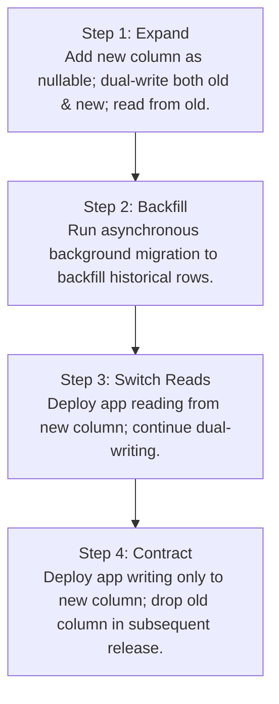

# Standard: Data, Databases, and Test Data

## 1. Purpose
Establishes proposed standards for database schema modeling, automated version-controlled migrations, zero-downtime schema evolution, query optimization, data classification, and secure test-data generation with strict privacy controls.

---

## 2. Zero-Downtime Database Migrations: The Expand-Contract Pattern

In production environments, modifying or deleting active database columns/tables while application instances are running can cause immediate service outages or lock timeouts. All breaking schema changes must follow the **Expand-Contract (Parallel Run)** procedure across separate deployment cycles:

### The 4 Migration Steps

1. **Step 1: Expand (Release $N$)**
   - Add the new column or table as `NULLABLE` (or with a safe default).
   - Never add `NOT NULL` without a default on an existing populated table (causes exclusive table lock).
   - Deploy application version that writes to **both** old and new columns, but continues reading from the old column.
2. **Step 2: Backfill (Asynchronous)**
   - Run a throttled, idempotent background script or worker to backfill data from the old column into the new column for historical rows.
   - Batch operations (e.g., 1,000 records per transaction) to avoid long-running locks or replication lag.
3. **Step 3: Switch Reads (Release $N+1$)**
   - Verify 100% data parity between old and new structures.
   - Deploy application version that now reads from the new column, while still maintaining dual writes if rollback safety is needed.
4. **Step 4: Contract (Release $N+2$)**
   - Deploy application version that writes only to the new column.
   - Run schema migration to drop the old column/table and any remaining triggers or legacy constraints.

---

## 3. Data Classification & Protection Matrix

All data stored or processed by agency-developed applications must be mapped into one of four sensitivity classifications:

| Classification | Definition & Examples | Encryption at Rest | Encryption in Transit | Retention & Purge Standard |
| :--- | :--- | :--- | :--- | :--- |
| **Public** | Marketing pages, public product catalogs, docs. | Optional | TLS 1.3 | Indefinite; managed via CDN cache. |
| **Internal** | Application configuration, aggregate business metrics, build logs. | AES-256 standard | TLS 1.3 | Rolling 90 to 365 days. |
| **Confidential** | Customer orders, business communications, invoices, usage logs. | AES-256 managed keys | TLS 1.3 (HSTS mandatory) | Active account + contractual period (e.g. 7 years for tax/financial). |
| **Restricted (PII / Secrets)** | Passwords, tokens, payment details, personal identifiers (SSN, ID), biometric data. | Field-level envelope encryption / Argon2id hashing | TLS 1.3 with strict cipher suites | Explicit deletion upon customer request / account termination. Zero plaintext in logs. |

---

## 4. Test Data Management & Anonymization

1. **Absolute Prohibition:** Never copy raw production databases or unmasked PII into local developer machines, testing environments, or CI runners.
2. **Synthetic Data Seeding:** Prefer programmatic generation of rich mock data using libraries such as Faker, FactoryBoy, or deterministic seed scripts.
3. **Anonymization Pipelines:** When staging environments require high-fidelity datasets:
   - Run an automated masking/scrubbing pipeline before export.
   - Hash or replace all customer emails (`user_123@anonymized.local`), telephone numbers, and addresses.
   - Truncate authentication credentials and API keys completely.

---

## 5. Related Documents
- [`./security-and-privacy-engineering.md`](./security-and-privacy-engineering.md): Cryptographic standards and vulnerability prevention.
- [`./ci-cd-and-release-engineering.md`](./ci-cd-and-release-engineering.md): Mixed-version trap and migration gates.
- [`../03-delivery-lifecycle/09-release-readiness-and-deployment.md`](../03-delivery-lifecycle/09-release-readiness-and-deployment.md): Pre-deployment rehearsal.
- [`../../12-legal-security-and-risk-management/README.md`](../../12-legal-security-and-risk-management/README.md): Legal and privacy governance.
