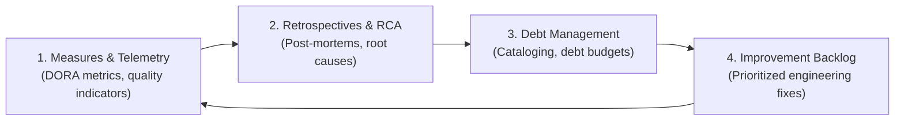

# 06. Engineering Improvement

> [!NOTE]
> **Candidate Practice / Proposed Scaffolding:** This document contains candidate material for research and evaluation. It does not constitute approved agency policy, mandatory instruction, or contractual commitment until formally reviewed and marked with `status: approved`.

This directory defines the proposed frameworks, metrics, learning loops, and continuous improvement mechanisms for Development and Engineering.

## Purpose

To ensure that engineering quality, delivery velocity, operational resilience, and developer satisfaction improve systematically over time through data-informed metrics, disciplined technical debt management, blameless retrospectives, and an actionable improvement backlog.

## The 4 Improvement Pillars

## Directory Navigation

| Document | Core Focus | Primary Benchmark |
| :--- | :--- | :--- |
| [`delivery-and-quality-measures.md`](./delivery-and-quality-measures.md) | Delivery performance metrics, lead times, defect escape rates | DORA Core Metrics |
| [`technical-debt-management.md`](./technical-debt-management.md) | Debt taxonomy, risk ranking, repayment budgets, tracking | Martin Fowler: Technical Debt |
| [`reuse-and-starter-templates.md`](./reuse-and-starter-templates.md) | Starter repositories, boilerplate curation, IP isolation | Internal Asset Reuse |
| [`retrospective-and-root-cause-learning.md`](./retrospective-and-root-cause-learning.md) | Milestone retrospectives, 5-Whys, blameless post-mortems | Google SRE Incident Management |
| [`improvement-backlog.md`](./improvement-backlog.md) | Prioritized backlog of internal developer tool and process enhancements | Continuous Improvement (Kaizen) |

## Related Agency Categories

- [`../../07-personal-and-professional-growth/README.md`](../../07-personal-and-professional-growth/README.md): Individual skill advancement and deliberate practice.
- [`../../09-internal-operations-and-work-management/README.md`](../../09-internal-operations-and-work-management/README.md): Agency-wide weekly retrospectives and capacity allocation.
- [`../../13-knowledge-systems-and-automation/README.md`](../../13-knowledge-systems-and-automation/README.md): Codifying retrospective lessons into updated playbooks.

## Open Questions

- What telemetry is lightweight enough to measure delivery performance without placing administrative burdens on developers?
- What percentage of sprint engineering capacity (e.g., 10%–20%) should be reserved for technical debt repayment and internal tool improvements?
