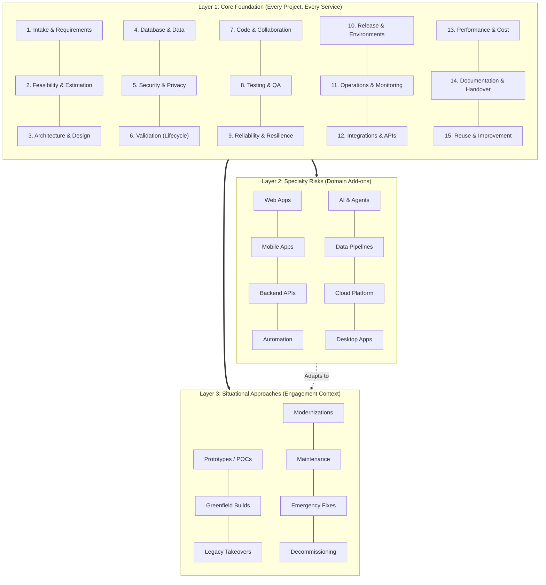

# Category 01: Development and Engineering

> [!NOTE]
> **Candidate Practice / Proposed Scaffolding:** This document contains candidate material for research and evaluation. It does not constitute approved agency policy, mandatory instruction, or contractual commitment until formally reviewed and marked with `status: approved`.

Welcome to the Development and Engineering knowledge base for our technology-services startup and agency.

This category establishes how the agency designs, builds, verifies, deploys, maintains, and decommissions software, applications, integrations, automation pipelines, and platform infrastructure.

---

## 1. Purpose and Scope

### Purpose
To ensure that all engineering deliverables achieve consistent architectural quality, high reliability, appropriate security, and practical maintainability while fostering rapid developer velocity and safe client handoffs.

### Scope
- Technical intake, feasibility assessment, and architecture design.
- Full delivery lifecycle execution from requirements to system retirement.
- Universal engineering standards (version control, secrets hygiene, testing, CI/CD, observability).
- Domain-specific service specialties (web, mobile, APIs, automations, AI systems, data pipelines).
- Diverse engagement patterns (prototypes, greenfield builds, legacy takeovers, modernizations, maintenance, emergency fixes).
- Continuous engineering improvement, DORA metrics, and technical debt management.

### Out of Scope (Boundaries with Other Categories)
- **Commercial Scoping & Pricing:** Managed by [`../05-sales/README.md`](../05-sales/README.md). Engineering provides technical estimates, feasibility inputs, and delivery assumptions.
- **Client Project Management & Contractual Commitments:** Managed by [`../11-project-delivery-and-client-service/README.md`](../11-project-delivery-and-client-service/README.md). Engineering executes technical milestones and provides delivery evidence.
- **Financial Controls & Budgets:** Managed by [`../10-finance-and-money-management/README.md`](../10-finance-and-money-management/README.md). Engineering supplies resource inputs and adheres to approved spending thresholds.
- **Legal Compliance & Security Policies:** Managed by [`../12-legal-security-and-risk-management/README.md`](../12-legal-security-and-risk-management/README.md). Legal establishes compliance rules; Engineering implements technical security controls and reports gaps.
- **Documentation Standards & Tooling Governance:** Managed by [`../13-knowledge-systems-and-automation/README.md`](../13-knowledge-systems-and-automation/README.md). Engineering owns the technical validity of its internal content.

---

## 2. The 3-Layer Development Architecture

To maintain high technical quality without drowning engineers in bureaucratic process, our engineering knowledge base is organized into **Three Interlocking Layers**:



### Layer 1: Core (Every Project, Every Service)
The universal engineering baseline applied to every engagement regardless of stack or size. Consists of 15 essential disciplines:
1. **Intake & Requirements:** [`03-delivery-lifecycle/01-technical-intake-and-handoff.md`](./03-delivery-lifecycle/01-technical-intake-and-handoff.md), [`03-delivery-lifecycle/02-discovery-and-requirements.md`](./03-delivery-lifecycle/02-discovery-and-requirements.md)
2. **Feasibility & Estimation:** [`03-delivery-lifecycle/05-feasibility-estimation-and-planning.md`](./03-delivery-lifecycle/05-feasibility-estimation-and-planning.md)
3. **Architecture & Design:** [`04-engineering-standards/architecture-and-technical-decisions.md`](./04-engineering-standards/architecture-and-technical-decisions.md), [`04-engineering-standards/ux-ui-and-accessibility.md`](./04-engineering-standards/ux-ui-and-accessibility.md), [`03-delivery-lifecycle/04-experience-and-solution-design.md`](./03-delivery-lifecycle/04-experience-and-solution-design.md)
4. **Database & Data:** [`04-engineering-standards/data-databases-and-test-data.md`](./04-engineering-standards/data-databases-and-test-data.md) *(SQL, NoSQL, vector DBs, migrations, isolation, retention)*
5. **Security & Privacy:** [`04-engineering-standards/security-and-privacy-engineering.md`](./04-engineering-standards/security-and-privacy-engineering.md), [`04-engineering-standards/environments-configuration-and-secrets.md`](./04-engineering-standards/environments-configuration-and-secrets.md), [`04-engineering-standards/dependencies-and-software-supply-chain.md`](./04-engineering-standards/dependencies-and-software-supply-chain.md)
6. **Validation Across the Lifecycle:** [`04-engineering-standards/validation-across-lifecycle.md`](./04-engineering-standards/validation-across-lifecycle.md), [`03-delivery-lifecycle/08-verification-and-client-acceptance.md`](./03-delivery-lifecycle/08-verification-and-client-acceptance.md) *(requirements, server inputs, acceptance)*
7. **Code & Collaboration:** [`04-engineering-standards/code-quality-and-review.md`](./04-engineering-standards/code-quality-and-review.md), [`04-engineering-standards/source-control-and-change-integration.md`](./04-engineering-standards/source-control-and-change-integration.md)
8. **Testing & QA:** [`04-engineering-standards/testing-and-quality-engineering.md`](./04-engineering-standards/testing-and-quality-engineering.md) *(unit, integration, E2E, accessibility)*
9. **Reliability & Resilience:** [`04-engineering-standards/reliability-and-resilience.md`](./04-engineering-standards/reliability-and-resilience.md) *(timeouts, retries with jitter, idempotency, circuit breakers)*
10. **Release & Environments:** [`04-engineering-standards/ci-cd-and-release-engineering.md`](./04-engineering-standards/ci-cd-and-release-engineering.md), [`03-delivery-lifecycle/09-release-readiness-and-deployment.md`](./03-delivery-lifecycle/09-release-readiness-and-deployment.md)
11. **Operations & Monitoring:** [`04-engineering-standards/observability-and-operational-readiness.md`](./04-engineering-standards/observability-and-operational-readiness.md), [`04-engineering-standards/backup-recovery-and-incident-engineering.md`](./04-engineering-standards/backup-recovery-and-incident-engineering.md), [`03-delivery-lifecycle/11-operation-maintenance-and-technical-closure.md`](./03-delivery-lifecycle/11-operation-maintenance-and-technical-closure.md)
12. **Integrations & APIs:** [`04-engineering-standards/api-and-integration-engineering.md`](./04-engineering-standards/api-and-integration-engineering.md) *(payments, communications, storage, webhooks, account ownership)*
13. **Performance & Cost:** [`04-engineering-standards/performance-and-capacity.md`](./04-engineering-standards/performance-and-capacity.md) *(Core Web Vitals, cloud hosting caps, AI token cost controls)*
14. **Documentation & Handover:** [`04-engineering-standards/technical-documentation.md`](./04-engineering-standards/technical-documentation.md), [`03-delivery-lifecycle/10-handover-and-support-transition.md`](./03-delivery-lifecycle/10-handover-and-support-transition.md), [`03-delivery-lifecycle/12-retirement-and-client-exit.md`](./03-delivery-lifecycle/12-retirement-and-client-exit.md)
15. **Reuse & Improvement:** [`04-engineering-standards/ai-assisted-development.md`](./04-engineering-standards/ai-assisted-development.md), [`06-engineering-improvement/technical-debt-management.md`](./06-engineering-improvement/technical-debt-management.md), [`06-engineering-improvement/reuse-and-starter-templates.md`](./06-engineering-improvement/reuse-and-starter-templates.md)

### Layer 2: Specialty Risks (`02-service-specialties/`)
Domain-specific technical considerations that layer on top of Layer 1 when delivering a particular class of solution:
- **AI Applications & Agents:** Prompt injection, tool sandboxing, evals, hallucination handling, human approval gates, vendor data retention, non-deterministic testing.
- **Web Applications & Websites:** Browser matrix compatibility, technical SEO, Core Web Vitals, cookie consent compliance.
- **Mobile Applications:** App store review guidelines, signing keystores, push notification token lifecycle, offline behavior.
- **Backend APIs & Integrations:** Semantic versioning, message queues, rate limits, webhook resilience.
- **Automation & Business Systems:** Platform execution limits, credential vaulting, automated failure alerting.
- **Data Engineering & Analytics:** Data quality tests, lineage tracking, idempotent batch scheduling, dashboard accuracy.
- **Cloud & Platform Engineering:** Infrastructure as Code, least-privilege IAM, cloud cost budgets.
- **Desktop Applications:** Native installers, code signing certificates, auto-update pipelines.

### Layer 3: Situational Approaches (`05-engagement-patterns/`)
Tailors the delivery rigor and lifecycle steps to the commercial archetype of the engagement:
1. **Prototypes & POCs:** Speed and hypothesis testing with lightweight guardrails.
2. **New Build Projects (Greenfield):** Comprehensive architecture and clean-code delivery.
3. **Existing Project Takeovers:** Code audits, stabilization, and liability boundaries.
4. **Modernization & Migrations:** Strangler-fig refactoring and zero-downtime data shifts.
5. **Ongoing Maintenance:** SLAs, recurring dependency patching, and retainers.
6. **Emergency Fixes & Hotfixes:** Expedited minimal diffs, urgent containment, and dual-merge back.
7. **Retirement & Decommissioning:** Cryptographic data erasure, cloud teardown, and exit audits.

---

## 3. The 4 Agency Realities

All technical standards in Category 01 must be grounded in these four operational agency realities:

1. **Multi-Client Isolation on Shared Tools:**
   - Agency-managed tooling (internal scripts, shared dev servers, automation accounts) must maintain strict logical and physical separation between clients.
   - *Production Account Rule:* Production services (AWS, Stripe, OpenAI, Apple Developer) must be owned directly by the client's legal entity, with agency engineers accessing them via role-based access. Agency corporate credit cards must never hold client production resources.
2. **Foreign Clients & Cross-Border Delivery:**
   - Engineering must account for asynchronous distributed collaboration, time zone disparities, international currencies, and localized user experiences.
   - *Regulatory Boundary:* Legal sets regulatory compliance policies (GDPR, EU ePrivacy, India's DPDP Act); Development implements and tests the technical controls (data residency, consent gates, automated deletion scripts).
3. **Small-Team Lightweight Constraint:**
   - Every standard and review gate must remain realistic and sustainable for a small, agile team.
   - Avoid bloated enterprise process overhead; favor automated CI checks, opinionated starters, and pragmatic checklists over bureaucratic committees.
4. **AI-Assisted Coding Boundaries:**
   - AI code generators and LLMs enhance developer velocity but introduce data leakage and security risks.
   - *Confidentiality Rule:* Never paste unmasked client secrets, production database dumps, or proprietary domain algorithms into commercial AI tools. All AI-generated code must undergo mandatory human peer review.

---

## 4. Directory Navigation

```text
01-development-and-engineering/
├── README.md                           # This orientation guide
├── coverage-matrix.md                  # Comprehensive mapping of all required engineering subjects
├── development-roadmap.md              # Status and priority tracking for all engineering areas
├── open-questions.md                   # Register of unresolved technical & architectural decisions
│
├── 01-engineering-governance/          # Roles, risk tailoring, review gates, exceptions, and ADR governance
│   ├── README.md
│   ├── roles-and-ownership.md
│   ├── project-risk-and-tailoring.md
│   ├── review-gates-and-evidence.md
│   ├── exceptions-and-escalation.md
│   └── engineering-decisions.md
│
├── 02-service-specialties/             # Layer 2: 8 domain specialties (all proposed & unconfirmed)
│   ├── README.md
│   ├── service-catalog.md
│   ├── web-applications-and-websites.md
│   ├── mobile-applications.md
│   ├── backend-apis-and-integrations.md
│   ├── automation-and-business-systems.md
│   ├── ai-applications-and-agents.md
│   ├── data-engineering-and-analytics.md
│   ├── cloud-and-platform-engineering.md
│   └── desktop-applications.md
│
├── 03-delivery-lifecycle/              # 12-stage technical progression from intake to decommissioning
│   ├── README.md
│   ├── 01-technical-intake-and-handoff.md
│   ├── 02-discovery-and-requirements.md
│   ├── 03-existing-system-assessment.md
│   ├── 04-experience-and-solution-design.md
│   ├── 05-feasibility-estimation-and-planning.md
│   ├── 06-project-engineering-setup.md
│   ├── 07-iterative-implementation.md
│   ├── 08-verification-and-client-acceptance.md
│   ├── 09-release-readiness-and-deployment.md
│   ├── 10-handover-and-support-transition.md
│   ├── 11-operation-maintenance-and-technical-closure.md
│   └── 12-retirement-and-client-exit.md
│
├── 04-engineering-standards/           # Layer 1: Universal technical practices (18 standards)
│   ├── README.md
│   ├── architecture-and-technical-decisions.md
│   ├── ux-ui-and-accessibility.md
│   ├── code-quality-and-review.md
│   ├── source-control-and-change-integration.md
│   ├── environments-configuration-and-secrets.md
│   ├── dependencies-and-software-supply-chain.md
│   ├── api-and-integration-engineering.md
│   ├── data-databases-and-test-data.md
│   ├── security-and-privacy-engineering.md
│   ├── validation-across-lifecycle.md
│   ├── testing-and-quality-engineering.md
│   ├── reliability-and-resilience.md
│   ├── performance-and-capacity.md
│   ├── ci-cd-and-release-engineering.md
│   ├── observability-and-operational-readiness.md
│   ├── backup-recovery-and-incident-engineering.md
│   ├── technical-documentation.md
│   └── ai-assisted-development.md
│
├── 05-engagement-patterns/             # Layer 3: Situational approaches (6 patterns + retirement cross-link)
│   ├── README.md
│   ├── prototypes-and-proofs-of-concept.md
│   ├── new-build-projects.md
│   ├── existing-project-takeovers.md
│   ├── modernization-and-migrations.md
│   ├── ongoing-maintenance.md
│   └── emergency-fixes.md
│
└── 06-engineering-improvement/         # Continuous improvement, DORA metrics, templates, post-mortems
    ├── README.md
    ├── delivery-and-quality-measures.md
    ├── technical-debt-management.md
    ├── reuse-and-starter-templates.md
    ├── retrospective-and-root-cause-learning.md
    └── improvement-backlog.md
```

> [!NOTE]
> In accordance with repository architecture rules ([`../../structure-guide.md`](../../structure-guide.md)), all external literature citations, candidate practice evaluations, and scenario validation logs reside centrally in [`../../research/01-development-and-engineering/`](../../research/01-development-and-engineering/README.md).

---

## 5. Core Boundary Clarifications

### 1. Decision Records: Org-Level vs. Engineering Governance vs. Architecture Decisions
- **[`../../decisions/`](../../decisions/README.md) (Org-Level Operating Decision Records - ODRs):** Governs firm-wide strategic, commercial, financial, and legal policies (e.g., choice of knowledge base architecture, company-wide tool licenses, billing terms, founder decision rights).
- **[`01-engineering-governance/engineering-decisions.md`](./01-engineering-governance/engineering-decisions.md) (Engineering Governance & Decision Authority):** Establishes the decision-making authority, escalation rules, risk tailoring, and process requirements for technical choices across the agency.
- **[`04-engineering-standards/architecture-and-technical-decisions.md`](./04-engineering-standards/architecture-and-technical-decisions.md) (Project-Level Architecture Decision Records - ADRs):** The technical standard prescribing *how* individual engineering projects record concrete architectural trade-offs within project repositories.

### 2. Service Specialty vs. Engineering Standard: Backend APIs & Integrations
- **[`02-service-specialties/backend-apis-and-integrations.md`](./02-service-specialties/backend-apis-and-integrations.md) (Service Specialty):** Defines the *commercial capability offering and domain scope*. Outlines service boundaries, client intake qualification, architectural constraints, and commercial delivery context for API deliverables.
- **[`04-engineering-standards/api-and-integration-engineering.md`](./04-engineering-standards/api-and-integration-engineering.md) (Universal Technical Standard):** Prescribes the *reusable engineering practice* applied across all projects—specifying OpenAPI 3.1 schema requirements, versioning conventions, idempotent mutations, cursor pagination, rate-limiting headers, and RFC 7807 error responses.

---

## 6. How Research Becomes an Approved Agency Instruction

To maintain credibility and prevent operational bloat, practices progress through a strict 6-stage lifecycle:

1. **Research & Evidence:** External standards (e.g., NIST SP 800-218, DORA, WCAG 2.2) are evaluated and cited in [`../../research/01-development-and-engineering/evidence-register.md`](../../research/01-development-and-engineering/evidence-register.md).
2. **Trade-off Analysis:** Candidate practices are analyzed for startup cost, complexity, and benefit in [`../../research/01-development-and-engineering/candidate-practices.md`](../../research/01-development-and-engineering/candidate-practices.md).
3. **Scenario Walkthrough:** The practice is stress-tested against realistic scenarios in [`../../research/01-development-and-engineering/validation-log.md`](../../research/01-development-and-engineering/validation-log.md).
4. **Founder Discussion & Decision:** Trade-offs are reviewed by leadership, and an Operating Decision Record is adopted in [`../../decisions/`](../../decisions/README.md).
5. **Drafting Standards & Playbooks:** Concrete guidelines are authored in `04-engineering-standards/` using the standard 8-part topic template ([`../../templates/engineering-topic-template.md`](../../templates/engineering-topic-template.md)).
6. **Production Pilot & Refinement:** The practice is tested in live client projects, monitored via DORA metrics, and refined through blameless post-mortems.

---

## 7. Where to Start

- **Next Step:** Begin topic-by-topic discussion with **Layer 1 Topic 1: Intake & Requirements** ([`03-delivery-lifecycle/01-technical-intake-and-handoff.md`](./03-delivery-lifecycle/01-technical-intake-and-handoff.md), [`03-delivery-lifecycle/02-discovery-and-requirements.md`](./03-delivery-lifecycle/02-discovery-and-requirements.md)).
- **Understand Subject Coverage:** Review [`coverage-matrix.md`](./coverage-matrix.md) to locate the canonical home for any technical topic.
- **Check Progress & Priorities:** Review [`development-roadmap.md`](./development-roadmap.md) to see active drafting priorities.
- **Review Open Technical Decisions:** Read [`open-questions.md`](./open-questions.md) to inspect pending architectural trade-offs.
- **Inspect Validated Evidence:** Read [`../../research/01-development-and-engineering/evidence-register.md`](../../research/01-development-and-engineering/evidence-register.md) to review primary reference standards.
