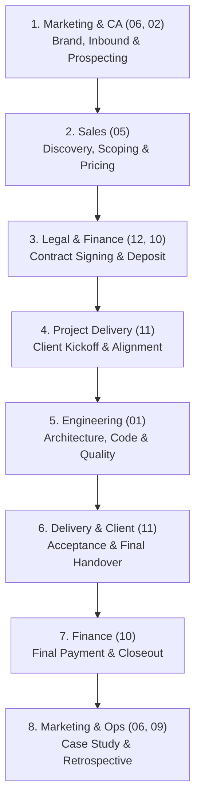

# Category 08: End-to-End Agency and Startup

## 1. Purpose
Orchestrates macro, cross-functional operational journeys that traverse multiple functional categories. It maps complete end-to-end lifecycles—from agency inception to complete client engagements and crisis response—ensuring smooth cross-category handoffs and holistic alignment.

## 2. Scope
- **The Complete Client Engagement Journey:** The overarching flow connecting lead acquisition, commercial discovery, sales closing, legal signing, deposit collection, delivery kickoff, engineering execution, acceptance, handover, and marketing case studies.
- **Agency Foundation & Inception Journey:** The holistic roadmap for standing up the agency (incorporation, banking, operational tooling, brand foundation, and core playbooks).
- **New Service Offering Launch Journey:** The multi-category path for bringing a new service from raw concept to market validation, delivery capability, and sales readiness.
- **Major Business Disruption & Crisis Management:** Cross-functional coordination when handling severe disruptions (e.g., loss of a primary client, critical security breach, severe cash crunch, or legal dispute).

## 3. Out of Scope (Boundaries)
- **Functional Procedure Duplication:** This category **MUST NOT** reproduce functional instructions that belong in specialized categories (e.g., code review steps belong in `01`, invoice issuing belongs in `10`, contract terms belong in `12`). It references and links them.
- **Miscellaneous Junk Drawer:** General or unassigned ideas do not belong here; unassigned ideas belong in [`../../ideas/`](../../ideas/README.md).
- **Daily Task Coordination:** Everyday sprint operations and task tracking belong to [`../09-internal-operations-and-work-management/`](../09-internal-operations-and-work-management/README.md).

## 4. Related Categories
- All 12 other categories connect directly through this cross-functional orchestration layer.

## 5. Candidate Playbooks and Workflows to Investigate
*(All items below are proposed candidates for future research and discussion; none are approved yet).*

- **[Proposed Workflow] Complete Client Engagement Lifecycle Map:** Macro flowchart and stage-gate requirements tracing a client relationship from initial touchpoint to offboarding and advocacy.
- **[Proposed Checklist] Agency Foundation & Launch Checklist:** Comprehensive verification checklist covering legal setup, financial accounts, tech stack, and operating playbooks.
- **[Proposed Playbook] Service Offering Incubation & Launch Playbook:** End-to-end framework coordinating Strategy (03), Marketing (06), Sales (05), Engineering (01), and Delivery (11) to launch a new service.
- **[Proposed Playbook] Business Disruption & Crisis Response Playbook:** Cross-functional escalation and communication protocols for existential operational, legal, or commercial crises.

## 6. Important Handoffs and Lifecycle Flow

## 7. Open Questions
- What are the mandatory sign-off gates required before advancing a client engagement from Sales to Kickoff, and from Delivery to Closure?
- How is overall accountability for an end-to-end client journey assigned if different people own Sales and Delivery?
- What triggers an emergency crisis meeting among founders?

## 8. Suggested Next Discussion Topics
1. Mapping the stages, inputs, and outputs of the full Client Engagement Lifecycle.
2. Formulating the initial Agency Foundation Checklist.
