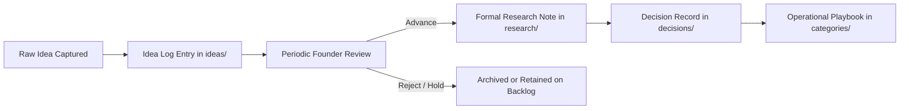

# Strategic Ideas and Review Records

This directory captures nascent strategic concepts, experimental service proposals, market hunches, and quarterly idea review logs before they enter formal research or operational drafting.

## Purpose

Agency innovation requires continuous idea capture without cluttering operational workflows with untested suggestions. This folder provides an intentional staging ground.

## Workflow for Ideas

## Note on Notion vs. Markdown Relationship

Earlier discussions identified Notion as a candidate tool for fast, lightweight capture of raw ideas and brainstorming. 

However, **the relationship between Notion and Markdown has not been finalized**:
- There is currently **no automated synchronization** implemented between Notion and this Markdown repository.
- Neither system should be assumed to be the sole authoritative duplicate of the other until an Operating Decision Record is adopted.
- Markdown remains the primary version-controlled foundation for all formal policies, playbooks, workflows, and operating records.
- See [`../open-questions.md`](../open-questions.md) for the active architectural question tracking this integration.

## Files in this Directory

- `idea-backlog.md`: Running collection of raw ideas categorized by theme.
- `YYYY-QX-idea-review.md`: Summary notes from periodic founder strategy and idea pruning sessions.
