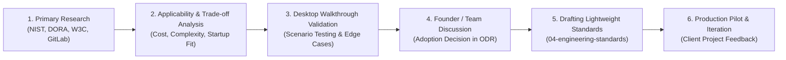

> [!NOTE]
> **Candidate Practice / Proposed Framework:** This document contains research and evaluation materials. It does not constitute approved agency policy, mandatory instruction, or contractual commitment until formally reviewed and marked with `status: approved`.

# Engineering Research and Evidence Plan

## 1. Purpose
Defines the systematic, targeted research process for investigating external engineering frameworks, establishing credibility, and preventing the adoption of arbitrary or unverified practices.

## 2. Research Principles
- **Distinguish Sources from Approvals:** Industry publications and peer benchmarks provide ideas and options, not automatic agency policy.
- **Prefer Primary Sources:** Rely on authoritative specifications and published research rather than secondary blog posts or promotional materials.
- **Record Limitations Honestly:** Note when a practice is intended for large enterprises and may incur unsustainable overhead for a small agency.
- **Evidence Before Codification:** No engineering practice will be mandated without documented problem context, trade-offs, and validation.

## 3. Reference Groups and Priority Research Domains

### Domain 1: Secure Software Development & Supply Chain Security
- **Core Reference:** NIST Special Publication 800-218 (Secure Software Development Framework - SSDF v1.1).
- **Research Focus:** Practical implementation of Prepare the Organization (PO), Protect the Software (PS), Produce Well-Secured Software (PW), and Respond to Vulnerabilities (RV) within small development teams.
- **Target Output:** Baseline secrets management, dependency vulnerability scanning, and secure code review practices.

### Domain 2: Delivery Performance & Reliability
- **Core Reference:** DevOps Research and Assessment (DORA) Capabilities (Google Cloud / dora.dev).
- **Research Focus:** Version control comprehensiveness (tracking code, config, tests, infra), automated testing feedback loops, trunk-based vs. feature-branch workflows, and continuous integration maturity.
- **Target Output:** Minimum viable CI/CD pipeline expectations and telemetry standards.

### Domain 3: Digital Accessibility & User Interface Quality
- **Core Reference:** W3C Web Accessibility Initiative (WAI) - Web Content Accessibility Guidelines (WCAG) 2.2.
- **Research Focus:** Integrating accessibility checks early in solution design and code reviews (focus appearance, minimum target size, accessible auth) rather than treating accessibility as an afterthought.
- **Target Output:** Baseline front-end accessibility checklist for client-facing web applications.

### Domain 4: Professional Services Delivery & Client Alignment
- **Core Reference:** GitLab Professional Services Delivery Methodology.
- **Research Focus:** Technical discovery, scoping, Definition of Ready (DoR), Definition of Done (DoD), delivery milestones, and formal technical handover to client teams.
- **Target Output:** Lifecycle handoff criteria between pre-sales scoping, delivery execution, and client sign-off.

## 4. Progressive Evaluation Lifecycle

## 5. Candidate Evidence Artifacts
- Formal entries in [`evidence-register.md`](./evidence-register.md).
- Detailed source notes in central repository [`../../research/`](../README.md).
- Candidate practice entries in [`candidate-practices.md`](./candidate-practices.md).

## 6. Next Actions
- [ ] Populate detailed citation and extract parameters for all primary reference groups.
- [ ] Conduct preliminary trade-off reviews on candidate CI/CD and dependency scanning tools.
