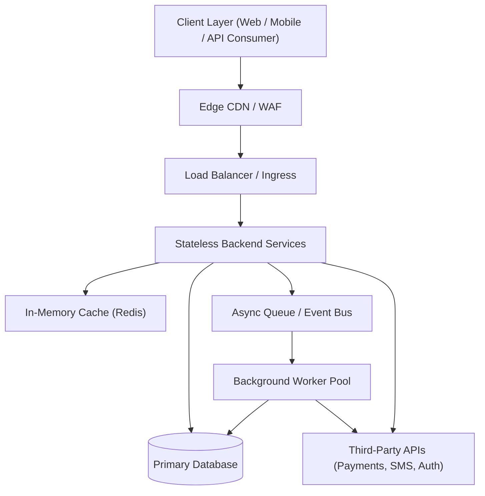

# Technical Foundation & System Design Document Template

> [!NOTE]
> **Candidate Template / Proposed Framework:** This template is candidate material for evaluation and scoping. It does not constitute approved agency policy, mandatory instruction, or contractual commitment until formally reviewed and marked with `status: approved`.

This document provides a comprehensive system architecture and foundation contract template for all technical initiatives, client engagements, and production services. It establishes the critical system parameters that are expensive or impossible to change once software is running in production.

> [!IMPORTANT]
> **The Foundation Gate Rule:**  
> Production implementation must not begin until every section of this foundation template has an explicit, documented answer. "I don't know yet" or "We will decide later" are invalid answers for production-bound systems. If an item cannot be answered, that uncertainty is the very first technical spike or discovery item to be resolved.

---

# System Foundation Contract: `[System / Engagement Name]`

- **Engagement / System Name:** `[Name]`
- **Client / Sponsoring Organization:** `[Client / Agency Internal]`
- **Technical Lead / Service Owner:** `[Name]`
- **Document Version:** `[0.1.0]`
- **Last Updated:** `[YYYY-MM-DD]`
- **Approval Status:** `[Proposed / Approved]`

---

## 1. Purpose & Business Context

- **Why does this application / system exist?**  
  `[Core justification and executive summary]`
- **What specific operational or customer problem does it solve?**  
  `[Concrete problem statement]`
- **Who is the target user?**  
  `[Specific user role, technical competency, environment, constraints]`
- **What is the business impact if this system is down for 1 hour?**  
  `[Direct financial loss, customer churn, reputational impact, SLA penalties]`
- **What is the business impact if this system is down for 1 week?**  
  `[Survival threat, regulatory breach, legal liability]`
- **Commercial Classification:**  
  `[ ] Revenue-generating core product`  
  `[ ] Mission-critical operational tool`  
  `[ ] Client internal automation / dashboard`  
  `[ ] Low-risk prototype / exploratory spike`
- **System Risk Tier:**  
  `[Critical (Tier 1) / High (Tier 2) / Medium (Tier 3) / Low (Tier 4)]`

---

## 2. Technical Ownership & Governance

Every production workload must have named individuals assigned to operational roles. "The team" is not an accountable owner.

| Role | Assigned Name | Primary Responsibilities |
| :--- | :--- | :--- |
| **Service Owner** | `[Name]` | Overall business and operational accountability |
| **Technical Owner / Lead** | `[Name]` | Architecture decisions, code review, deployment sign-off |
| **Data Owner** | `[Name]` | Data governance, sensitivity classification, retention, regulatory compliance |
| **Security & Privacy Lead** | `[Name]` | Vulnerability review, secret handling, incident escalation |
| **Primary On-Call Responder** | `[Name]` | First responder to production alerts, triage, MTTR ownership |
| **Secondary Escalation** | `[Name]` | Backup responder, deep engineering escalation |

- **Escalation Path:** `[Primary -> Secondary -> Technical Lead -> Executive/Client Rep]`
- **Officially Supported Use Cases:** `[Explicit list of supported workflows and constraints]`
- **Explicitly Prohibited Use Cases:** `[Unauthorized usage, prohibited data classes, out-of-scope traffic]`

---

## 3. User Journey, Workflows & Failure Modes

Map all critical user transitions from initiation to value fulfillment, identifying failure vectors and telemetry targets upfront.

| Step | User Action | System Action | Potential Failure Modes | Metric / Event Emitted |
| :---: | :--- | :--- | :--- | :--- |
| `1` | `[e.g., User initiates checkout]` | `[Validates cart & locks inventory]` | `[Inventory lock timeout, cart mismatch]` | `checkout_initiated` |
| `2` | `[e.g., Submits payment details]` | `[Calls payment gateway token]` | `[Gateway 5xx, insufficient funds]` | `payment_submitted` |
| `3` | `[e.g., Receives confirmation]` | `[Dispatches email & creates order]` | `[Webhook drop, worker queue crash]` | `order_completed` |

- **Core Activation Flow:** `[Description of onboarding/first value path]`
- **Primary Value-Delivery Action:** `[The single key action representing delivered value]`
- **Payment / Transaction Flow:** `[Billing or transactional execution path]`
- **Data Deletion / Cancellation Flow:** `[Account closure, export, and secure purge]`
- **Operational Support Flow:** `[Where user goes when broken]`

---

## 4. North Star Metric & Value Indicators

- **North Star Metric:** `[Single metric that best represents user value delivered]`

| Supporting Metric | Operational Definition | Target Threshold | Measurement Source |
| :--- | :--- | :--- | :--- |
| **User Activation** | `[% completing first core value step]` | `[e.g., > 65%]` | Product Analytics |
| **Retention (D1)** | `[% returning after 24 hours]` | `[e.g., > 40%]` | Telemetry DB |
| **Retention (D7)** | `[% active in week 1]` | `[e.g., > 25%]` | Telemetry DB |
| **Retention (D30)** | `[% active in month 1]` | `[e.g., > 15%]` | Telemetry DB |
| **Conversion Rate** | `[% converting to paid/committed]` | `[e.g., > 3.5%]` | Billing Ledger |
| **Satisfaction (CSAT/NPS)** | `[Feedback survey aggregate]` | `[e.g., NPS > +45]` | User Feedback |

- **Definition of Success at 3 Months:** `[Clear objective criteria]`
- **Definition of Failure / Pivot Threshold:** `[Clear conditions indicating failure]`

---

## 5. Service Level Objectives (SLOs) & Error Budgets

Commitments on production behavior defining the boundary between acceptable operation and unacceptable degradation.

| Indicator (SLI) | Target Objective (SLO) | Measurement Window | Error Budget | Alerting Strategy |
| :--- | :--- | :--- | :--- | :--- |
| **Availability** | `[e.g., 99.9%]` | 30-day rolling | `0.1% (43.2 min downtime)` | P1 on 2% budget burn in 1h |
| **Latency (p95)** | `[e.g., < 250ms]` | 5-minute window | `5% exceeding 250ms` | P2 warning alert |
| **Latency (p99)** | `[e.g., < 800ms]` | 5-minute window | `1% exceeding 800ms` | P2 warning alert |
| **Error Rate (5xx)** | `[e.g., < 0.1%]` | 5-minute window | `0.1% total requests` | P1 page on sustained spike |
| **Crash-Free Sessions**| `[e.g., > 99.8%]` | 7-day rolling | `0.2% sessions` | Daily review |
| **Data Durability** | `[e.g., 99.999999999%]`| Annual | 0 unrecoverable records | Immediate crisis escalation |

### Error Budget Policy
- **100% to 50% remaining:** Normal feature delivery velocity.
- **50% to 25% remaining:** Heightened deployment review; high-risk architectural changes paused.
- **25% to 0% remaining:** Non-critical deployments frozen; team focuses exclusively on bugs and stability.
- **0% (Budget Exhausted):** Complete feature freeze. 100% engineering effort diverted to reliability engineering, root-cause fixes, and SLO restoration.

---

## 6. Non-Functional Requirements (NFRs)

### Performance & Throughput
- Page load / initial paint (p95): `[e.g., < 1.5s]`
- Core API roundtrip (p95): `[e.g., < 200ms]`
- Asynchronous batch job processing window: `[e.g., < 15 minutes]`

### Scalability
- Launch user concurrency: `[Expected peak concurrent users]`
- 6-month scale horizon: `[Projected scale]`
- Peak Request Rate: `[Peak RPS / queries per second]`
- Elastic Scaling Strategy: `[Horizontal pod autoscaling / serverless concurrency / vertical sizing]`

### Reliability & Disaster Recovery
- **Recovery Time Objective (RTO):** `[Maximum acceptable duration to restore service, e.g., < 2 hours]`
- **Recovery Point Objective (RPO):** `[Maximum acceptable data loss window, e.g., < 15 minutes]`
- Primary failure domains & redundancy mechanisms: `[Multi-AZ, cross-region replication, circuit breakers]`
- Graceful degradation mode: `[Fallback behavior when external dependencies fail]`

### Security, Secrets & Compliance
- Identity & Access: `[OAuth 2.0 / OIDC / MFA requirement]`
- Secret Management: `[Vault / AWS Secrets Manager / SOPS; zero plaintext secrets in repos or code]`
- Data Encryption: `[TLS 1.3 in transit; AES-256 at rest]`
- Vulnerability Scanning: `[Automated SAST, DAST, and container vulnerability scanning on CI]`

### Sustainability & Cost
- Monthly Cloud Infrastructure Cap: `[$ amount / month]`
- Cost Alert Thresholds: `[Alert at 80% and 100% of budgeted monthly burn]`

---

## 7. Architecture & System Design

### Component Breakdown
| Component | Chosen Technology | Architectural Role | Stateless / Stateful | Failure Mitigation |
| :--- | :--- | :--- | :--- | :--- |
| **Frontend UI** | `[e.g., Next.js]` | User interface rendering | Stateless | Static fallback pages |
| **Application API** | `[e.g., FastAPI / Node]` | Business logic & endpoints | Stateless | Auto-restart, replica scaling |
| **Primary Store** | `[e.g., PostgreSQL]` | Relational state & transactions | Stateful | Multi-AZ standby, point-in-time recovery |
| **Cache Store** | `[e.g., Redis]` | Session store & query caching | Ephemeral | Fail-open bypass to DB |
| **Queue / Broker** | `[e.g., RabbitMQ / SQS]`| Async background execution | Stateful | Dead-letter queues, idempotent retry |

### External Dependencies
| Dependency | Purpose | Failure Consequence | Resiliency Pattern / Fallback |
| :--- | :--- | :--- | :--- |
| `[e.g., Stripe API]` | Payment processing | Cannot accept revenue | Exponential backoff, user retry UI |
| `[e.g., SendGrid]` | Transactional email | Notifications delayed | Queue retry with dead-letter alert |

---

## 8. Data Classification & Lifecycle

| Data Type | Sensitivity Level | Encryption (Rest/Transit) | Retention Policy | Purge / Sanitization Standard |
| :--- | :--- | :--- | :--- | :--- |
| **User PII (Names, Emails)** | Confidential | AES-256 / TLS 1.3 | Active account + 30 days | Cryptographic erasure / hard delete |
| **Authentication Secrets** | Restricted | Argon2id / TLS 1.3 | Immediate invalidation | Zero plaintext persistence |
| **Financial / Billing Records**| Confidential | AES-256 / TLS 1.3 | 7 years (tax/legal) | Secure archive, access-restricted |
| **Application Access Logs** | Internal | AES-256 / TLS 1.3 | 90 days rolling | Automated bucket lifecycle purge |
| **Telemetry / Usage Events** | Internal (Masked) | Standard | 365 days aggregated | No raw PII permitted |

---

## 9. Observability & Telemetry Architecture

1. **Structured Logging:**
   - Format: JSON formatted stdout.
   - Standard Fields: `timestamp` (ISO 8601 UTC), `level`, `service`, `correlation_id`, `user_id` (hashed), `event`, `message`, `context`.
2. **Metrics Collection:**
   - Services: **RED Method** (Rate, Errors, Duration).
   - Infrastructure: **USE Method** (Utilization, Saturation, Errors).
3. **Distributed Tracing:**
   - Standard: OpenTelemetry instrumentation propagating W3C `traceparent`.
4. **Health Check Probes:**
   - `/health/live`: Process liveness; returns HTTP 200 if server process is running.
   - `/health/ready`: Dependency readiness; returns HTTP 200 only if critical downstream connections (DB, Cache) respond.

---

## 10. Event Taxonomy & Analytics Tracking

Standard Event Naming Syntax: `<object>_<action>` (lower_snake_case).

| Event Identifier | Trigger Condition | Mandatory Properties | Telemetry Layer |
| :--- | :--- | :--- | :--- |
| `user_registered` | Successful account creation | `user_id, auth_provider, source` | Server-side (Authoritative) |
| `project_created` | Project workspace created | `user_id, project_id, template` | Server-side |
| `checkout_completed` | Payment confirmed by gateway | `user_id, order_id, amount_cents` | Server-side |
| `feature_clicked` | User activates UI toggle | `user_id, session_id, feature_name` | Client-side (UI) |

> [!CAUTION]
> **PII Telemetry Ban:** Never pass cleartext passwords, tokens, payment card numbers, or government IDs into event tracking or log statements.

---

## 11. Initial Risk Register & Mitigations

| Risk ID | Identified Risk Scenario | Probability | Impact | Proposed Mitigation Strategy | Contingency Plan |
| :---: | :--- | :---: | :---: | :--- | :--- |
| `R-01` | Downstream API rate limits exceeded | Medium | High | Implement token-bucket client rate limiting & caching | Fallback degraded mode |
| `R-02` | Database migration lock timeout during release | Low | High | Expand-contract zero-downtime migration protocol | Immediate migration rollback |
| `R-03` | Team key person dependency | Medium | Medium | Shared pair reviews, mandatory architecture docs | Secondary lead shadowing |

---

## 12. Foundation Gate Sign-Off Record

Before any production code is committed or deployed:

- [ ] All 11 preceding sections contain complete, approved entries.
- [ ] Technical Owner has reviewed and approved the architecture.
- [ ] Service Owner has approved the SLOs, NFRs, and error budget policy.
- [ ] Data Owner has approved the data classification and retention rules.
- [ ] Security Lead has reviewed the threat model and secrets handling.

| Role | Sign-off Name | Signature / Approval Reference | Date Approved |
| :--- | :--- | :--- | :--- |
| **Service Owner** | `[Name]` | `[Reference ID]` | `[YYYY-MM-DD]` |
| **Technical Lead** | `[Name]` | `[Reference ID]` | `[YYYY-MM-DD]` |
| **Data Owner** | `[Name]` | `[Reference ID]` | `[YYYY-MM-DD]` |
